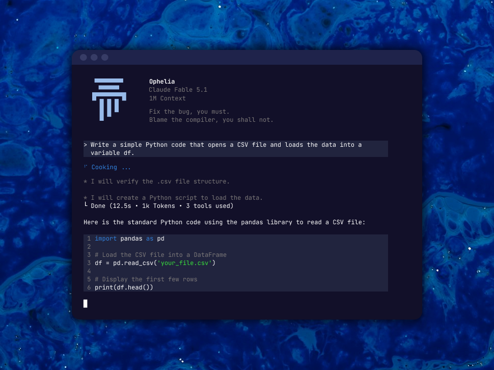

# ophelia-cli

[](https://langchain.com/)
[](https://www.python.org/)
[](https://docs.astral.sh/uv/)

<p align="center">
  
</p>

Ophelia is an AI coding assistant that lives directly in your terminal. It helps you work with your codebase through natural language commands, with the goal of simplifying code editing, test execution, and development workflows — all from your command line.

<p align="center">
  
</p>

> **Note:** Ophelia is under active development. Features, commands, and workflows may change as the project evolves.

## Get Started

### Prerequisites

- [Python 3.12 or later](https://www.python.org/downloads/)
- [uv](https://docs.astral.sh/uv/getting-started/installation/)

### Installation

**1. Clone the repository**

```bash
git clone https://github.com/TelecomAI/ophelia-cli.git
cd ophelia-cli
```

**2. Install dependencies**

uv creates a virtual environment, resolves dependencies, and installs the project.

```bash
uv sync
```

**3. Configure your environment**

If your current implementation requires environment variables, create a local environment file:

```bash
cp .env.example .env
```

Add the credentials required by your configured LLM provider. Never commit secrets or your `.env` file.

**4. Launch Ophelia**

```bash
uv run ophelia
```

You're ready to start exploring Ophelia and contributing to its development!

## Development

Ophelia uses [uv](https://docs.astral.sh/uv/) for dependency management and [Ruff](https://docs.astral.sh/ruff/) for linting and formatting.

**Run tests**

```bash
uv run pytest
```

**Check code quality**

```bash
uv run ruff check .
uv run ruff format --check .
```

**Format the code**

```bash
uv run ruff format .
```

**Add a dependency**

```bash
uv add <package-name>
```

**Add a development dependency**

```bash
uv add --dev <package-name>
```

Commit both `pyproject.toml` and `uv.lock` whenever dependency changes are made.

## Report Bugs

Found a bug or something that doesn't work as expected? We welcome your feedback!

Use the `/bug` command directly within Ophelia to report issues, or [open an issue on GitHub](https://github.com/TelecomAI/ophelia-cli/issues).

## Connect on Discord

Join the [Telecom AI community on Discord](https://discord.gg/eWtE472wVr) to get help, share ideas, discuss Ophelia, and connect with other developers building with AI.

## Contributing

Ophelia is an evolving project, and contributions are welcome. Whether you're fixing a bug, proposing a feature, or improving the developer experience, your input helps shape the project.

Before submitting changes, run the test suite and code-quality checks described in the Development section.

## License

See the [LICENSE](LICENSE) file for licensing information.
